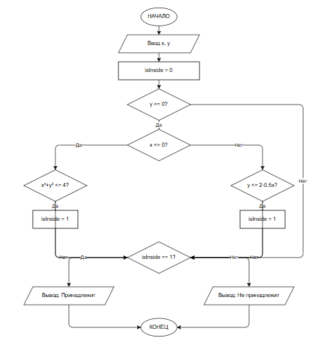

# Домашнее задание к работе 6

## Условие задачи
**Написать программу, которая определяет, принадлежит ли точка с заданными координатами (x, y) заштрихованной области. Область состоит из двух частей: четверти круга радиусом 2 (при x ≤ 0, y ≥ 0) и прямоугольного треугольника, ограниченного осями и прямой y = 2 - 0.5x (при x ≥ 0, y ≥ 0).**

---

## 1. Алгоритм и блок-схема

### Алгоритм
1. **Начало**
2. **Ввод данных:**
   - Считать координату x
   - Считать координату y
3. **Инициализация:**
   - Установить флаг принадлежности `isInside = 0`
4. **Проверка условий:**
   - Если `y >= 0`:
     - Если `x <= 0`: проверить условие круга `x * x + y * y <= 4`. Если истинно → `isInside = 1`
     - Иначе (если `x > 0`): проверить условие треугольника `y <= 2 - 0.5 * x`. Если истинно → `isInside = 1`
5. **Вывод результата:**
   - Если `isInside == 1` → Вывести "Точка принадлежит области"
   - Иначе → Вывести "Точка не принадлежит области"
6. **Конец**
   
### Блок-схема
 
## 2. Реализация программы
```c
int TaskDZ() {
    float x, y;
    printf("Введите координату x: ");
    scanf("%f", &x);
    printf("Введите координату y: ");
    scanf("%f", &y);

    int isInside = 0;

    if (y >= 0) {
        if (x <= 0) {
            if (x * x + y * y <= 4) {
                isInside = 1;
            }
        }
        else {
            if (y <= 2 - 0.5 * x) {
                isInside = 1;
            }
        }
    }
    if (isInside) {
        printf("Точка (%.2f, %.2f) Принадлежит области\n", x, y);
    }
    else {
        printf("Точка (%.2f, %.2f) Не принадлежит области\n", x, y);
    }

    return 0;
}
```
## 3. Результаты работы программы
Введите координату x: 23
Введите координату y: 22
Точка (23,00, 22,00) Не принадлежит области
## 4. Информация о разработчике
Тухватулин Евгений Романович, бТИИ-261
